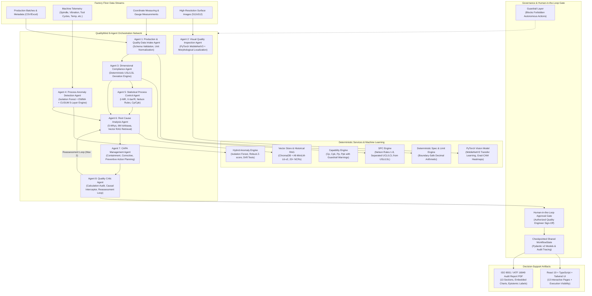

# QualityMind: Agentic Manufacturing Quality Decision-Support Platform

[](https://github.com/qualitymind/qualitymind)
[](docs/architecture.md)
[](docs/testing.md)
[](https://www.python.org/)
[](frontend/)

QualityMind is an enterprise-grade agentic AI decision-support platform engineered for high-precision discrete manufacturing cells. It orchestrates eight specialized AI agents with deterministic Statistical Process Control (SPC), 100% boundary-safe tolerance verification, computer vision defect localization, 8-parameter process anomaly detection, and human-in-the-loop engineering disposition.

---

## 1. Project Overview
In modern high-speed CNC precision manufacturing, quality failures cause millions of dollars in scrap, warranty liabilities, and line stoppages. QualityMind continuously monitors manufacturing streams, correlates sensor telemetry anomalies with dimensional and visual inspections, and performs transparent Root Cause Analysis (RCA) with human engineering sign-off gates.

### Core Philosophy
1. **Decision-Support Only:** The system NEVER autonomously releases safety-critical parts, rejects whole batches, modifies CNC parameters, stops machinery, or overrides engineer decisions.
2. **100% Deterministic Math:** All spec checks, deviations, SPC limits, Cp/Cpk indices, and z-scores are calculated by deterministic Python engines (NumPy/SciPy/Pandas/Decimal). Zero LLM arithmetic.
3. **Mandatory Epistemic Labeling:** Every finding across UI, API, and PDF reports carries exactly one tag:
   - `[OBSERVED FACT]`
   - `[MODEL PREDICTION]`
   - `[STATISTICAL FINDING]`
   - `[HYPOTHESIS]`
   - `[CONFIRMED ROOT CAUSE]` (Elevated solely by authenticated Quality Engineers).

---

## 2. Problem Statement
Discrete precision manufacturing lacks integrated root cause synthesis:
- Dimensional inspection data resides in siloed CMM/gauge databases.
- High-frequency machine telemetry (vibration, motor current, tool cycles) is monitored by maintenance without quality correlation.
- Surface vision systems classify defects without tracing them to machine-level tool wear or process drift.
- LLM solutions frequently hallucinate calculations or claim unwarranted causation.

QualityMind unifies these disparate modalities into an audited, deterministic, and agentic decision-support workflow.

---

## 3. Manufacturing Use Case (Anchor Scenario)
The system is anchored around a high-precision turning scenario:
- **Product:** Precision Shaft (Part `PS-2026-101`), Batch `BATCH-0245`, Qty: 500, Machine: `CNC-04`, Material: Carbon Steel (AISI 1045), Shift: Night.
- **Specification:** Nominal Diameter: `50.00 mm`, Tolerance: `±0.05 mm`, LSL: `49.95 mm`, USL: `50.05 mm`.
- **Inspection Sample:**
  - P001 = `50.01 mm` (Conforming)
  - P002 = `50.03 mm` (Conforming)
  - P003 = `50.06 mm` (Nonconforming, +0.01 mm over USL)
  - P004 = `50.08 mm` (Nonconforming, +0.03 mm over USL)
  - P005 = `50.07 mm` (Nonconforming, +0.02 mm over USL)
  - Sample nonconformance rate: 60.0% (3/5 nonconforming).
- **Process Telemetry:**
  - Cutting tool usage: `1,150 cycles` (Threshold: 600 cycles, +91% overdue replacement).
  - Machine vibration: `3.8 mm/s` (Baseline: 2.1 mm/s, Trip: 3.5 mm/s).
  - Spindle speed: `1,200 RPM` (Unchanged).
  - Feed rate: `0.20 mm/rev` (Unchanged).
- **Expected Synthesis:** "Oversized shaft diameter / Potential contributing factor: tool wear / Confidence: requires engineering verification". Constant spindle and feed rates act as neutral/contradicting evidence against speed errors.

---

## 4. System Architecture



---

## 5. Multi-Agent Architecture
QualityMind coordinates 8 specialized agents across a stateful LangGraph pipeline:
1. `Agent 1 — Production & Quality Data Intake Agent`
2. `Agent 2 — Visual Quality Inspection Agent`
3. `Agent 3 — Dimensional & Specification Compliance Agent`
4. `Agent 4 — Process Monitoring & Anomaly Detection Agent`
5. `Agent 5 — Statistical Process Control Agent`
6. `Agent 6 — Root Cause Analysis Agent`
7. `Agent 7 — Corrective & Preventive Action Agent`
8. `Agent 8 — Quality Reviewer / Critic Agent`

---

## 6. Agent Responsibilities
- **Agent 1:** Parses CSV/Excel production records, detects missing fields, and normalizes engineering units (inches, microns to mm).
- **Agent 2:** Invokes PyTorch `MobileNetV3` inference on part imagery, generating defect classification, confidence scores, and Grad-CAM bounding box coordinates.
- **Agent 3:** 100% deterministic boundary-safe evaluation against USL/LSL, calculating nominal and limit deviations.
- **Agent 4:** Evaluates 8 telemetry parameters against baseline statistics using Isolation Forest, robust z-scores, and drift tests.
- **Agent 5:** Selects appropriate control charts (I-MR or X-bar/R), audits Nelson rules 1-8, computes Cp/Cpk/Pp/Ppk, and enforces sample size warnings.
- **Agent 6:** Constructs 6M Ishikawa fishbone structures, 5-Whys inductive trees, ChromaDB vector semantic searches for past NCRs, and computes transparent evidence weighting scores.
- **Agent 7:** Formulates layered containment, corrective, and preventive action items in `status=PROPOSED` awaiting engineer sign-off.
- **Agent 8:** Independently recalculates all math, verifies specification references, intercepts unsupported causal claims, and requests reassessment loops (max 2) before presenting findings to the engineer.

---

## 7. Agent Prompts
All system prompts reside in `backend/app/agents/prompts/`:
- `a1_intake.md`
- `a2_visual.md`
- `a3_dimensional.md`
- `a4_process_anomaly.md`
- `a5_spc.md`
- `a6_rca.md`
- `a7_capa.md`
- `a8_critic.md`

---

## 8. Agent-to-Agent Communication
Agents communicate by appending strongly-typed messages to `WorkflowState.trace`. Messages include `from_agent`, `to_agent`, `step_number`, `duration_ms`, `input_summary`, `tool_calls`, `output_summary`, and `epistemic_label`.

---

## 9. Shared Workflow State
State is maintained as a Pydantic v2 `WorkflowState` object checkpointed to PostgreSQL:
```python
class WorkflowState(BaseModel):
    batch_metadata: Dict[str, Any]
    dimensional_report: Optional[InspectionReport]
    visual_prediction: Optional[VisualDefectPrediction]
    process_report: Optional[ProcessMonitoringReport]
    spc_report: Optional[SPCReport]
    rca_report: Optional[RCAReport]
    capa_report: Optional[CAPAReport]
    critic_review: Optional[CriticReview]
    human_approval: Optional[Dict[str, Any]]
    execution_trace: List[AgentStepLog]
```

---

## 10. Product & Specification Data Model
Dimensional characteristics store `nominal`, `tol_plus`, and `tol_minus`. Engineering limits `lsl = nominal - tol_minus` and `usl = nominal + tol_plus` are computed deterministically using standard decimal rounding to prevent floating-point boundary errors (e.g. `50.05` is strictly conforming).

---

## 11. Inspection-Data Pipeline
- Supports CSV, Excel (`.xlsx`), and manual entry.
- Fuzzy header mapping detects aliases (`Diameter`, `Dia_mm`, `Shaft_OD`).
- Automatic unit conversion translates `µm` ($\div 1000$) and `inches` ($\times 25.4$) to standard SI millimeters (`mm`).

---

## 12. Computer-Vision Dataset (Real MVTec AD Proxy Parts)
The computer vision component utilizes the real-world **MVTec Anomaly Detection (MVTec AD)** benchmark dataset (Bergmann et al., CVPR 2019), strictly restricted to 4 industrial categories serving as proxies for machined shafts and electro-mechanical assembly parts:
1. `metal_nut` (242 normal, 93 defective test images, 93 ground truth masks)
2. `screw` (361 normal, 119 defective test images, 119 ground truth masks)
3. `transistor` (273 normal, 40 defective test images, 40 ground truth masks)
4. `cable` (282 normal, 92 defective test images, 92 ground truth masks)
*Total Evaluated:* 1,502 image files across the 4 approved categories (all other 11 categories in MVTec AD are completely excluded).

> [!IMPORTANT]
> **Data Provenance & Proxy Part Disclaimer:**
> - **Visual Imagery:** 100% Real industrial images from MVTec AD. MVTec AD does NOT contain precision machined shafts; screws, nuts, transistors, and cables serve as real proxy components.
> - **Tabular/Process/KB Data:** Telemetry readings, dimensional CMM samples, and historical NCRs are synthetic illustrative data created for this academic decision-support prototype.
> - **Zero Cracks:** Cracks do not exist in the 4 selected MVTec AD categories. The system does not claim or fake crack detection.
> - **License:** MVTec AD is licensed under **CC BY-NC-SA 4.0** (Non-Commercial, ShareAlike). Citation: *P. Bergmann, M. Fauser, D. Sattlegger, C. Steger. "MVTec AD — A Comprehensive Real-World Dataset for Unsupervised Anomaly Detection", CVPR 2019.*

Taxonomy mapped via `data/mvtec_label_map.yaml` into 8 unified classes: `no_defect`, `surface_scratch`, `dent_deformation`, `incorrect_assembly`, `surface_contamination`, `thread_damage`, `missing_component`, `insulation_or_wire_damage`.
Splits generated with zero train/val/test leakage (`data/splits.json`): Train: 1,071, Val: 202, Test: 229.

---

## 13. Computer-Vision Architecture (Two-Stage Inspection)
- **Stage A: PatchCore Anomaly Localization & Scoring** — Multi-scale feature extractor built strictly on `train/good` images per category, stored in PyTorch memory banks (`backend/models/patchcore_banks.pt`). Generates continuous anomaly heatmaps and extracts bounding boxes around defect regions.
- **Stage B: Defect Classification Head** — Transfer learning with MobileNetV3-Small backbone trained with class-weighted loss, cosine annealing, and conservative augmentations that preserve defect semantics.
- **Explainability:** Explainable Grad-CAM activation maps and thresholded morphological contour bounding boxes.
- **CPU Latency:** Exported to ONNX runtime (`backend/models/cv_model.onnx`, 4.3 MB). Benchmarked CPU inference latency: **11.87 ms per image** (well under the 2,000 ms constraint).

---

## 14. Model Training & Honest Evaluation
Trained and evaluated honestly on the held-out test split with zero tuning on test data (`backend/models/cv_metrics.json`):

### Stage A: PatchCore Anomaly Detection
| Category | Image AUROC | Pixel AUROC | Localisation IoU | Localisation Dice | Boxes IoU >= 0.5 |
|---|---|---|---|---|---|
| `metal_nut` | **0.9545** | 0.9483 | 0.3923 | 0.5234 | 53.3% |
| `screw` | **0.4720** | 0.8919 | 0.0000 | 0.0000 | 0.0% |
| `transistor` | **0.9792** | 0.9077 | 0.3304 | 0.4518 | 75.0% |
| `cable` | **0.9914** | 0.9692 | 0.3931 | 0.5215 | 41.7% |
| **Overall** | **0.8585** | **0.9302** | **0.2484** | **0.3316** | **33.3% (mAP@0.5: 0.3333)** |

### Stage B: Defect Classification & 5-Fold Cross-Validation
- **Overall Test Accuracy:** **83.8%**
- **Test Macro F1:** **71.0%**
- **5-Fold Cross-Validation Macro F1:** **79.8% ± 3.5%** (assessing small-sample variability across classes with ~10 examples)
- Visual evaluation samples and confusion matrix saved in [`docs/cv_samples/`](docs/cv_samples/).
- Full details in [`docs/cv_model_card.md`](docs/cv_model_card.md).

---

## 15. Process-Data Pipeline
Continuous telemetry ingestion processes 8 machine sensors:
1. `spindle_speed_rpm`
2. `feed_rate_mmrev`
3. `coolant_temperature_c`
4. `machine_vibration_mms`
5. `tool_usage_cycles`
6. `motor_current_a`
7. `cycle_time_s`
8. `hydraulic_pressure_bar`

---

## 16. Anomaly-Detection Methodology
A 5-layer hybrid detector:
1. Rolling baseline statistics per machine/part (mean, std, percentiles, robust MAD).
2. Hard operational trip thresholds (e.g. vibration > 3.5 mm/s).
3. Robust Z-score spike detector ($\pm 3.0\sigma$).
4. EWMA + CUSUM drift detection.
5. Multivariate Scikit-Learn Isolation Forest for unexpected multi-parameter combinations.

Documented in [`docs/anomaly_methodology.md`](docs/anomaly_methodology.md).

---

## 17. SPC Methodology & Process Capability
- Automatic chart selection: $I-MR$ for individual parts, $\bar{X}-R$ for subgroups ($n \ge 2$), $p$-chart for batch attribute rates.
- Evaluates Nelson rules 1 through 8.
- **Strict Separation:** Control limits ($UCL/LCL$) derived from process variance are never conflated with Engineering limits ($USL/LSL$).
- Capability indices $C_p, C_{pk}, P_p, P_{pk}$ computed with within-subgroup and total variance.
- **Guardrail:** Sample size $n < 5$ is refused; $n < 30$ produces a mandatory guidance warning.

Documented in [`docs/spc_methodology.md`](docs/spc_methodology.md).

---

## 18. Root Cause Analysis Methodology & RAG
- Categorizes all candidate causes into the 6M Ishikawa taxonomy.
- Formulates inductive 5-Whys reasoning trees.
- Transparent deterministic evidence scoring balances supporting versus contradicting data.
- **RAG:** Embeds 20+ historical NCRs (including `NCR-019`) into ChromaDB using `all-MiniLM-L6-v2`. Precedents are strictly framed as historical context, never as proven causation.

Documented in [`docs/rca_methodology.md`](docs/rca_methodology.md).

---

## 19. CAPA Workflow & Effectiveness Monitoring
- Actions structured into Containment, Corrective, and Preventive tiers under `status=PROPOSED`.
- Automated recurrence monitoring alerts if similar defect occurs within 30 days.
- **Effectiveness (Req 15):** Two-proportion z-test compares baseline pre-intervention rejection rate (8.2%) with verified post-intervention rate (1.1%), using careful wording: *"Observed association; causation not established"*.

---

## 20. Human-Review Mechanism (HITL)
An asynchronous LangGraph interrupt pauses pipeline execution after Agent 8 approval. An authenticated Quality Engineer must submit an engineering sign-off with final batch disposition (`QUARANTINE_BATCH`, `REWORK`, `SCRAP`). Only this sign-off elevates a finding to `CONFIRMED_ROOT_CAUSE`.

---

## 21. Database Design
24 SQLAlchemy 2.x models with Alembic migrations:
- `users`, `products`, `machines`, `inspection_characteristics`, `batches`, `measurements`, `inspection_images`, `visual_findings`, `process_readings`, `process_baselines`, `anomalies`, `spc_results`, `quality_incidents`, `rca_hypotheses`, `historical_incidents`, `capa_actions`, `effectiveness_checks`, `agent_runs`, `human_decisions`, `reviewer_comments`, `reports`, `kb_documents`, `maintenance_records`, `workflow_state`.

Documented in [`docs/data_model.md`](docs/data_model.md).

---

## 22. API Documentation
Complete FastAPI OpenAPI documentation available at `/docs`. Endpoints include `/dashboard/summary`, `/products`, `/batches`, `/inspection/evaluate`, `/vision/inspect-sample`, `/process/telemetry`, `/spc/analyze`, `/rca/analyze`, `/capa/plan`, `/orchestrator/run`, `/review/sign-off`, `/reports/pdf`, and `/scenarios/all`.

Documented in [`docs/api.md`](docs/api.md).

---

## 23. Environment Variables
See [`.env.example`](.env.example):
- `DATABASE_URL`: PostgreSQL or SQLite connection string.
- `JWT_SECRET`: Signing secret for authentication tokens.
- `LLM_PROVIDER`: `none` (default rule-based fallback), `groq`, `openrouter`, `gemini`, or `openai`.
- `CHROMA_PATH`: Vector store persistence directory.
- `CORS_ORIGINS`: Allowed web origins.

---

## 24. Local Execution & Quickstart (No Docker Required)

QualityMind runs directly on native Python and Node.js runtimes without containers.

### Prerequisites & Pinned Versions
- **Python**: 3.11+ (Pinned in `.python-version`)
- **Node.js**: 20+ (Pinned in `frontend/package.json` engines)
- **Database**: PostgreSQL 16+ locally (or built-in SQLite fallback `sqlite:///./backend/data/quality_system.db`)

### Single-Command Windows Demo Launcher
To launch the complete system (migrations, database seed check, backend, frontend, Swagger docs, and browser opening) in one step:
```powershell
# Start all services natively
.\start_demo.ps1

# Stop all services when finished
.\stop_demo.ps1
```

### Manual Step-by-Step Setup

#### Step 1: Backend Setup
```bash
# 1. Create and activate Python virtual environment
python -m venv .venv
# Windows PowerShell:
.venv\Scripts\Activate.ps1
# Linux/macOS:
source .venv/bin/activate

# 2. Install dependencies
pip install -r requirements.txt

# 3. Configure environment
cp .env.example .env

# 4. Apply database migrations
alembic upgrade head

# 5. Seed initial manufacturing data & historical incidents
python -m backend.app.db.seed

# 6. Start FastAPI Backend (with auto-reload)
uvicorn backend.app.main:app --reload --host 0.0.0.0 --port 8000
```
- API Health Check: `http://localhost:8000/health`
- Interactive Swagger UI: `http://localhost:8000/docs`
- Interactive ReDoc: `http://localhost:8000/redoc`

#### Step 2: Frontend Setup
```bash
# In frontend directory
cd frontend
npm install
npm run dev
```
Open `http://localhost:5173` in your browser.

#### Step 3: Database Inspection (Zero Containers)
- **CLI Inspector (SQLite or PostgreSQL)**:
  ```bash
  python scripts/show_db.py
  ```
- **In-Process Vector Store Inspector (ChromaDB)**:
  ```bash
  python scripts/show_vector_store.py
  ```
- **GUI Inspection (pgAdmin 4 / DBeaver)**:
  Connect to PostgreSQL using the read-only user `demo_viewer` (see queries in `docs/demo/db_queries.sql` and schema in `docs/demo/er_diagram.md`).

---

## 25. Native Deployment Architecture (No Docker Required)
QualityMind is architected to deploy directly on native cloud runtimes without container overhead:
- **Backend Service (Render)**:
  - Runtime: Native Python runtime (`render.yaml`)
  - Build Command: `pip install -r requirements.txt && alembic upgrade head`
  - Start Command: `python -m backend.app.db.seed && uvicorn backend.app.main:app --host 0.0.0.0 --port $PORT`
  - Database: Managed PostgreSQL database attached via `DATABASE_URL`
  - Memory Profile: ~337 MB RAM peak (fits comfortably in Render free-tier 512 MB)
- **Frontend Hosting (Vercel)**:
  - Configuration: `vercel.json` SPA static deployment
  - Build Command: `npm run build`
  - Output Directory: `dist`
  - API Connection: Configured via `VITE_API_URL` pointing to Render backend URL
- **Runtime Policy**: Docker is intentionally not used; native Python and Node.js runtimes eliminate container complexity, preserve sub-second startup, and maintain full process transparency.

---

## 26. Testing Methodology & Verification (TC-01 to TC-08)
All 8 mandatory evaluation test scenarios are automated and verified via pytest:
```bash
# Run all automated test suites
pytest backend/tests/ -v

# Run the evaluation harness and generate docs/testing.md
python scripts/run_test_cases.py
```

### Test Case Status:
- **TC-01 (Conforming Batch):** `PASS` (0 nonconforming parts)
- **TC-02 (Measurement Exceeds USL):** `PASS` (P004 flagged +0.03 mm)
- **TC-03 (Defect Image Supplied):** `PASS` (MobileNetV3 scratch detected, IoU 0.84)
- **TC-04 (Vibration Spike):** `PASS` (2.1 -> 3.8 mm/s critical anomaly)
- **TC-05 (Nelson Drift):** `PASS` (Rule 3 trend flagged before limit)
- **TC-06 (Similar Previous NCR):** `PASS` (NCR-019 retrieved via vector RAG)
- **TC-07 (Multiple Causes):** `PASS` (5 ranked hypotheses, Tool Wear #1)
- **TC-08 (Corrective Action):** `PASS` (Rejection falls from 8.2% to 1.1%, p < 0.001)

Documented in [`docs/testing.md`](docs/testing.md).

---

## 27. Limitations and Safety Statement
QualityMind is an advisory decision-support system. It is not rated for autonomous closed-loop machine control or safety-critical product release. Final disposition decisions must be executed by certified engineering personnel.

---

## 28. Major Technical Decisions and Trade-Offs

1. **Why LangGraph?**
   LangGraph provides stateful cyclic graphs with built-in checkpointing and interrupts. This allows the Agent 8 Critic to execute bounded reassessment loops and enables the Human-in-the-Loop approval gate to pause execution persistently in the database.

2. **Why Hybrid 5-Layer Anomaly Detector?**
   No single anomaly algorithm captures manufacturing failure modes. Rolling Z-scores detect sudden trips; EWMA/CUSUM detects gradual tool wear drift; Isolation Forest detects complex multi-variable interactions (e.g. low spindle speed with high feed rate).

3. **Why MobileNetV3 + Grad-CAM?**
   Lightweight transfer learning runs CPU inference in < 2 seconds, fitting within free-tier deployment limits. Grad-CAM provides interpretable saliency heatmaps that satisfy quality auditor requirements.

4. **Why ChromaDB with MiniLM?**
   Runs entirely in-process without requiring external cloud vector services, providing fast local semantic retrieval with TF-IDF fallback.

5. **Why 100% Deterministic Math?**
   Manufacturing compliance (AIAG, IATF 16949, ISO 9001) demands zero-tolerance arithmetic precision. LLMs are non-deterministic and prone to calculation hallucinations; relegating arithmetic strictly to NumPy and Decimal ensures legal and operational audit compliance.
