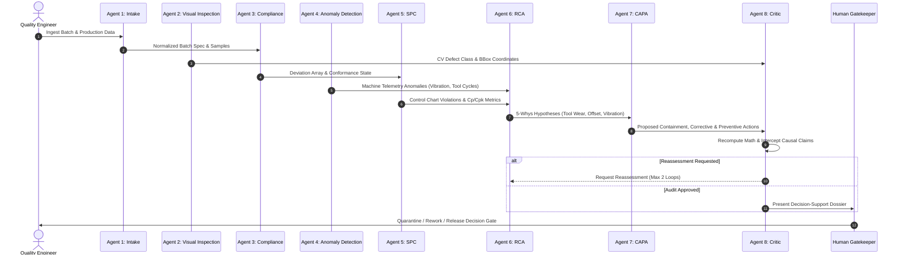

# Multi-Agent Orchestration Specification: 8 Specialized Agents

## 1. Overview & Communication Protocol
QualityMind orchestrates eight specialized agents across an asynchronous, stateful LangGraph pipeline. Communication is handled via strongly-typed agent messages appended to `WorkflowState.trace`.

---

## 2. Agent Catalog & Responsibilities

### Agent 1: Production & Quality Data Intake Agent
- **Role:** Fast, deterministic intake engine paired with forced JSON schema validation (`DataIntakeOutput`). Normalizes engineering units (inches, microns, centimeters $\to$ mm), performs fuzzy column matching, and validates mandatory batch metadata.
- **Processing Mode:** Hybrid deterministic parser (NumPy/Pandas regex) + forced Pydantic v2 JSON schema. Fast non-reasoning LLM (`gemini-3.5-flash-lite`, fallback `gpt-oss-20b`) is utilized for unstructured text extraction with forced JSON schema.
- **Unit Conversion Auditing:** Explicitly logs every conversion in `unit_conversions` (`sample_id`, `original_value`, `original_unit`, `converted_value_mm`).
- **Gating Mechanism (`needs_info`):** If critical parameters (`nominal_mm`, `tolerance_mm`, etc.) are missing, sets `needs_info=True` with explicit warnings, causing LangGraph conditional router `route_after_intake` to halt downstream processing.
- **Epistemic Output:** `OBSERVED_FACT`
- **Prompt:** `backend/app/agents/prompts/a1_intake.md`
- **Tools:** `tool_parse_csv_stream`, `tool_structure_raw_samples`, `tool_load_benchmark_anchor_lot`

### Agent 2: Visual Quality Inspection Agent
- **Role:** Process 512x512 surface images using PyTorch transfer learning (`MobileNetV3`), localizing scratches, dents, and cracks with Grad-CAM saliency bounding boxes.
- **Epistemic Output:** `MODEL_PREDICTION`
- **Prompt:** `backend/app/agents/prompts/a2_visual.md`
- **Tools:** `run_cv_model`, `compute_gradcam`, `extract_bounding_boxes`

### Agent 3: Dimensional Compliance Agent
- **Role:** 100% deterministic evaluation of measurements against Upper Specification Limits (USL) and Lower Specification Limits (LSL) with Decimal boundary safety.
- **Epistemic Output:** `OBSERVED_FACT`
- **Prompt:** `backend/app/agents/prompts/a3_dimensional.md`
- **Tools:** `compute_tolerance_limits`, `check_conformance`, `compute_deviations`

### Agent 4: Process Anomaly Detection Agent
- **Role:** Monitor 8 operational machine telemetry streams (spindle speed, feed rate, coolant temperature, vibration, tool cycles, motor current, cycle time, pressure) using a 5-layer hybrid detector.
- **Epistemic Output:** `STATISTICAL_FINDING` (threshold/z-score) / `MODEL_PREDICTION` (Isolation Forest)
- **Prompt:** `backend/app/agents/prompts/a4_process_anomaly.md`
- **Tools:** `get_machine_baselines`, `detect_isolation_anomalies`, `test_drift`

### Agent 5: Statistical Process Control (SPC) Agent
- **Role:** Auto-select control chart types (I-MR, X-bar/R, p-chart), evaluate Nelson rules 1-8, compute Cp/Cpk/Pp/Ppk, and enforce sample-size guardrails.
- **Epistemic Output:** `STATISTICAL_FINDING`
- **Prompt:** `backend/app/agents/prompts/a5_spc.md`
- **Tools:** `build_control_chart`, `evaluate_nelson_rules`, `calculate_capability`

### Agent 6: Root Cause Analysis (RCA) Agent
- **Role:** Formulate 6M Ishikawa fishbone hypotheses, execute 5-Whys inductive reasoning chains, retrieve past NCRs via ChromaDB RAG, and compute transparent evidence weights.
- **Epistemic Output:** `HYPOTHESIS`
- **Prompt:** `backend/app/agents/prompts/a6_rca.md`
- **Tools:** `search_historical_ncr`, `correlate_telemetry`, `score_hypotheses`

### Agent 7: Corrective & Preventive Action (CAPA) Agent
- **Role:** Propose layered containment, corrective, and preventive action plans under `status=PROPOSED`, awaiting human sign-off.
- **Epistemic Output:** `STATISTICAL_FINDING` (for effectiveness) / Proposed Actions
- **Prompt:** `backend/app/agents/prompts/a7_capa.md`
- **Tools:** `propose_containment`, `propose_corrective`, `propose_preventive`

### Agent 8: Quality Critic Agent
- **Role:** Independent calculation re-verifier, specification reference validator, unsupported causal claim interceptor (regex filter), and safety gatekeeper.
- **Epistemic Output:** `STATISTICAL_FINDING`
- **Prompt:** `backend/app/agents/prompts/a8_critic.md`
- **Tools:** `recompute_math`, `audit_spec_references`, `check_causal_assertions`
