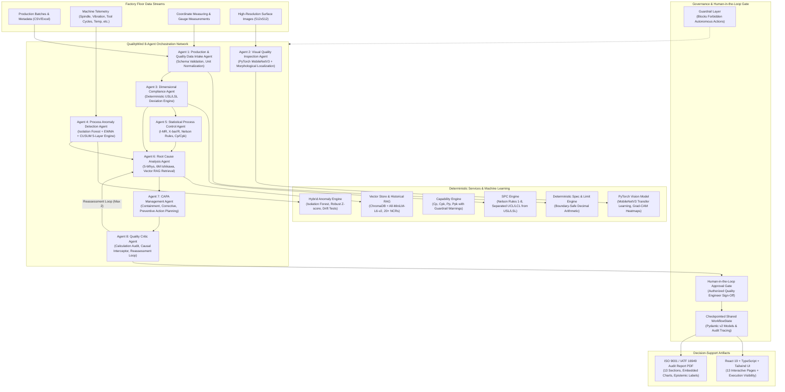

# QualityMind System Architecture

## Overview
QualityMind is an enterprise agentic manufacturing quality decision-support platform designed for high-precision discrete manufacturing (e.g. CNC machining, precision shafts, hydraulic components). It coordinates 8 specialized AI agents with deterministic engineering engines, computer vision defect inspection, Statistical Process Control (SPC), 8-parameter process anomaly detection, and human-in-the-loop governance.

---

## Architecture Diagram (Mermaid)

---

## Core System Subsystems

### 1. Deterministic Calculation Core
In strict adherence to manufacturing quality standards (AIAG, ISO 9001, IATF 16949), all arithmetic calculations are executed by verified Python libraries (`NumPy`, `SciPy`, `Pandas`, `Decimal`). An LLM is never permitted to perform arithmetic or evaluate part conformance.

### 2. Multi-Agent Orchestration & Shared WorkflowState
All 8 agents execute against a centralized, strongly-typed Pydantic v2 `WorkflowState`. State modifications are tracked with step execution records including elapsed time in milliseconds, input summaries, tool calls, and epistemic labeling.

### 3. Epistemic Labeling Taxonomy
Every finding across the API, frontend, and PDF export is tagged with exactly one label:
1. `OBSERVED_FACT`: Direct, verified physical measurements or batch properties.
2. `MODEL_PREDICTION`: Machine learning outputs (e.g. computer vision defect inference).
3. `STATISTICAL_FINDING`: 3-sigma statistical control limit evaluations, telemetry z-scores, and anomaly signals.
4. `HYPOTHESIS`: Root cause hypotheses generated through inductive reasoning and historical retrieval.
5. `CONFIRMED_ROOT_CAUSE`: Physical defect origin authorized and stamped by a certified Quality Engineer.
