# QualityMind Entity-Relationship (ER) Diagram
**Generated from SQLAlchemy Active Schema (`backend/app/db/models.py`)**  
**Database Support:** PostgreSQL (Production / Render) and SQLite (Local Development)

```mermaid
erDiagram
    USERS ||--o{ PRODUCTION_BATCHES : operates
    USERS ||--o{ CAPA_ACTIONS : approves
    MACHINES ||--o{ PRODUCTION_BATCHES : processes
    MACHINES ||--o{ PROCESS_BASELINES : calibrates
    MACHINES ||--o{ PROCESS_TELEMETRY : streams
    MACHINES ||--o{ MAINTENANCE_RECORDS : undergoes
    PRODUCTS ||--o{ PRODUCTION_BATCHES : manufactures
    PRODUCTS ||--o{ INSPECTION_CHARACTERISTICS : specifies
    PRODUCTS ||--o{ HISTORICAL_INCIDENTS : associates

    PRODUCTION_BATCHES ||--o{ BATCH_MEASUREMENTS : contains
    PRODUCTION_BATCHES ||--o{ PROCESS_TELEMETRY : records
    PRODUCTION_BATCHES ||--o{ INSPECTION_EVALUATIONS : triggers
    PRODUCTION_BATCHES ||--o{ QUALITY_INCIDENTS : generates

    QUALITY_INCIDENTS ||--o{ CAPA_ACTIONS : mitigates

    USERS {
        string id PK
        string email
        string password_hash
        string name
        string role "ADMIN | QUALITY_ENGINEER | OPERATOR"
        datetime created_at
    }

    MACHINES {
        string id PK "e.g. CNC-04"
        string name
        string type
        string location
        string status
    }

    PRODUCTS {
        string id PK "e.g. PROD-SHAFT-50"
        string part_number "PS-2026-101"
        string name
        string material
        float nominal_dimension "50.00"
        float tolerance_plus "0.05"
        float tolerance_minus "0.05"
        string unit "mm"
    }

    INSPECTION_CHARACTERISTICS {
        string id PK
        string product_id FK
        string characteristic_name "Shaft Outer Diameter"
        float nominal_value
        float usl "50.05"
        float lsl "49.95"
        string unit
    }

    PROCESS_BASELINES {
        string id PK
        string machine_id FK
        string parameter_name "e.g. vibration_radial_rms"
        float baseline_mean "2.1"
        float baseline_std "0.2"
        string unit "mm/s"
    }

    PRODUCTION_BATCHES {
        string id PK "e.g. BATCH-0245"
        string product_id FK
        string machine_id FK
        string operator_id FK
        int total_units "5"
        int nonconforming_units "3"
        string status "QUARANTINED | COMPLETED | RELEASED"
        datetime created_at
    }

    BATCH_MEASUREMENTS {
        string id PK
        string batch_id FK
        string part_serial "P001..P005"
        float measured_value "50.01..50.08"
        float deviation "0.00..0.03"
        boolean is_conforming
        float tolerance_usage_pct
        datetime measured_at
    }

    PROCESS_TELEMETRY {
        string id PK
        string batch_id FK
        string machine_id FK
        string parameter_name
        float measured_value
        string unit
        boolean is_anomalous
        string severity "NORMAL | WARNING | CRITICAL"
        datetime timestamp
    }

    INSPECTION_EVALUATIONS {
        string id PK
        string batch_id FK
        string agent_name "Agent 1..8"
        string status "COMPLETED | IN_PROGRESS"
        text result_json
        datetime created_at
    }

    QUALITY_INCIDENTS {
        string id PK "INC-2026-001"
        string batch_id FK
        string defect_type "DIMENSIONAL_OVERSIZE"
        string severity "HIGH"
        string epistemic_status "HYPOTHESIS | STATISTICAL_FINDING | CONFIRMED_ROOT_CAUSE"
        string confirmed_root_cause "Tool Flank Wear"
        string disposition "SCRAP | REWORK | USE_AS_IS"
        datetime created_at
    }

    CAPA_ACTIONS {
        string id PK "CAPA-2026-001"
        string incident_id FK
        string action_type "CONTAINMENT | CORRECTIVE | PREVENTIVE"
        string title
        text description
        string assigned_role "Maintenance Lead | Quality Engineer"
        string status "PENDING_APPROVAL | IN_PROGRESS | COMPLETED"
        boolean requires_engineering_approval "true"
        string approved_by FK
        date due_date
        datetime completed_at
    }

    HISTORICAL_INCIDENTS {
        string id PK "NCR-019"
        string part_number FK
        string defect_type
        string root_cause "Tool Wear"
        text description
        text resolution
    }

    MAINTENANCE_RECORDS {
        string id PK
        string machine_id FK
        string maintenance_type "TOOL_REPLACEMENT"
        text notes
        datetime performed_at
    }
```



---

## Read-Only Demonstration Role Configuration (PostgreSQL)

To provide database inspection access without containers (e.g. via **pgAdmin 4** or **DBeaver**):

```sql
-- 1. Create a dedicated read-only role
CREATE ROLE demo_viewer WITH LOGIN PASSWORD 'your_secure_password_from_env';

-- 2. Grant connection and schema usage
GRANT CONNECT ON DATABASE qualitymind TO demo_viewer;
GRANT USAGE ON SCHEMA public TO demo_viewer;

-- 3. Grant SELECT on all existing and future tables
GRANT SELECT ON ALL TABLES IN SCHEMA public TO demo_viewer;
ALTER DEFAULT PRIVILEGES IN SCHEMA public GRANT SELECT ON TABLES TO demo_viewer;
```

### Connection Settings for pgAdmin / DBeaver:
- **Host**: `localhost` (local) or your Render Postgres host
- **Port**: `5432`
- **Database**: `qualitymind` (or `qualitymind_db`)
- **Username**: `demo_viewer`
- **Password**: Provided securely via `.env` (`DEMO_VIEWER_PASSWORD`)
